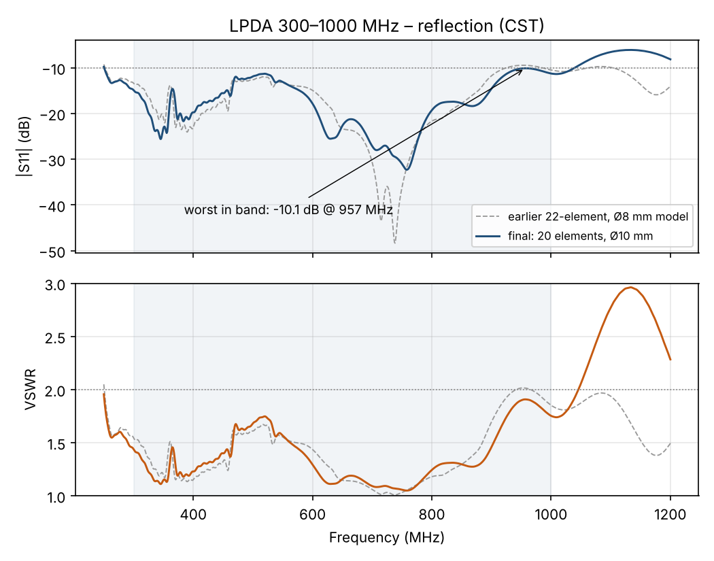
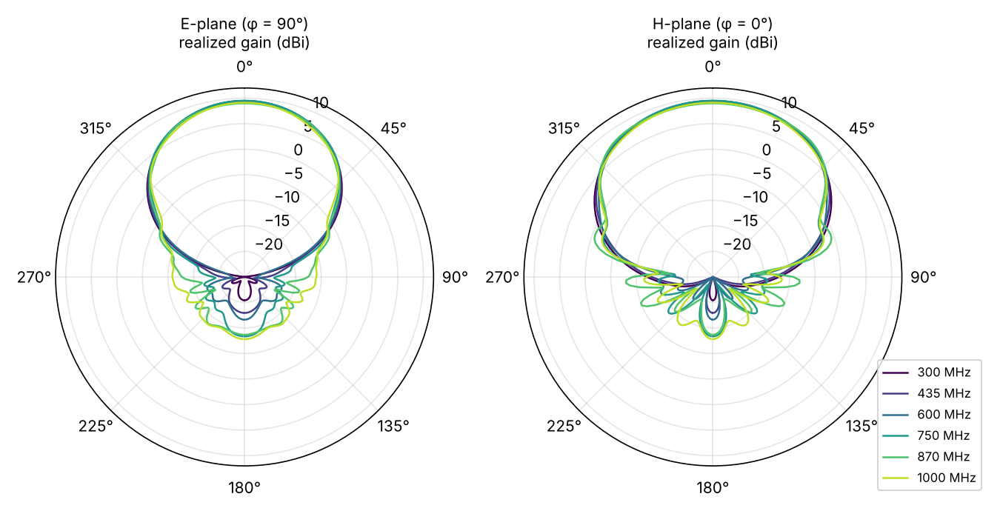
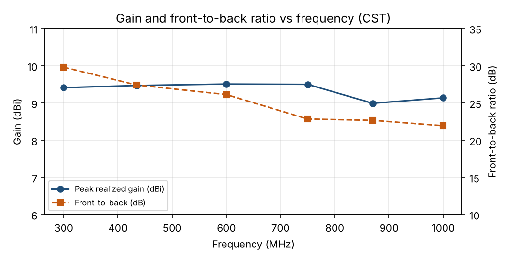

# 300–1000 MHz Log-Periodic Dipole Array (LPDA)

A 20-element, twin-boom log-periodic dipole array covering 300–1000 MHz, designed and full-wave simulated in CST Studio Suite for fabrication from aluminium with demountable elements.

*Türkçe açıklama: [README.tr.md](README.tr.md)*

## Key results (CST, as-built geometry)

| Quantity | Value |
|---|---|
| Band | 300–1000 MHz (3.3 : 1) |
| Matching | S11 below −10 dB across the whole band (worst −10.1 dB at 957 MHz), VSWR ≤ 1.91 |
| Peak realized gain | 9.0–9.5 dBi |
| Front-to-back ratio | 22–30 dB |
| 3 dB beamwidth | E-plane 57–62°, H-plane 80–89° |

| Frequency (MHz) | Gain (dBi) | F/B (dB) | HPBW E / H (°) |
|---|---|---|---|
| 300 | 9.4 | 29.8 | 59 / 82 |
| 435 | 9.5 | 27.4 | 58 / 81 |
| 600 | 9.5 | 26.1 | 58 / 80 |
| 750 | 9.5 | 22.9 | 60 / 84 |
| 870 | 9.0 | 22.7 | 62 / 89 |
| 1000 | 9.1 | 22.0 | 57 / 83 |

Full table: [`performans_tablosu.csv`](performans_tablosu.csv). F/B and beamwidths are computed from the exported far-field tables (boresight vs. θ = 180°; −3 dB points in the φ = 90° and φ = 0° cuts).

## Design

| Parameter | Value |
|---|---|
| Scale factor τ / spacing factor σ | 0.90 / 0.13 |
| Elements | 20, Ø10 mm aluminium rod |
| Longest / shortest element (tip to tip) | 555.2 mm / 75.0 mm |
| Booms | two 15 × 15 × 1.5 mm square aluminium tubes, ~1.41 m long |
| Boom gap | 7.5 mm, set by POM (Delrin) spacers |
| Rear short | 37.5 × 15 × 3 mm aluminium plate on the top face of both booms (stub 138.8 mm behind element 1) |
| Feed | RG-316 routed inside boom A (infinite balun); shield to boom A, centre conductor to boom B at the front end. Simulated as an ideal 50 Ω discrete port |

Element lengths, rod cut lengths and positions: [`eleman_tablosu.csv`](eleman_tablosu.csv).

Element dimensions follow the Carrel procedure (each element τ times the previous one, spacing set by σ). The feed position, front extension and boom gap were tuned with a seven-run CST sweep ([`sonuclar/sweep/`](sonuclar/sweep/)). For fabrication the design was then updated to the as-built geometry: 20 instead of 22 elements (elements 21–22 resonate near 2.2–2.5 GHz, far above the band), Ø10 mm instead of Ø8 mm rods, and the rear short moved to the top face of the booms. The final simulation of that geometry is in [`sonuclar/export_d10/`](sonuclar/export_d10/); the earlier 22-element, Ø8 mm results are kept in [`sonuclar/export/`](sonuclar/export/) and drawn dashed in the S11 plot.

## Construction

Each rod is held by an M4 bolt that passes through the boom from the opposite face and screws into a thread tapped in the rod end, so every element can be removed for transport. A step-by-step 3D assembly guide (in Turkish) with the cut list, drilling plan and feed routing is in [`uretim/montaj_rehberi.html`](uretim/montaj_rehberi.html); download and open it in a browser.

## Reproducing the results

1. Open `cst/lpda.cst` in CST Studio Suite 2025 or later.
2. Run the time-domain solver (**Start Simulation**). Result folders are not included because of their size.
3. `cst-makrolar/lpda_sonuc_aktar.bas` exports the S-parameters and far-field tables used here.

## Limitations

- The simulation uses an ideal 50 Ω discrete port; the coaxial cable inside the boom, the bolts and nuts are not modelled.
- Not yet measured; VNA and pattern measurements of the built antenna will be added.

## Files

| Path | Contents |
|---|---|
| `cst/lpda.cst` | CST model of the as-built antenna |
| `cst-makrolar/` | result export macro |
| `sonuclar/export_d10/` | final simulation: `lpda_20el_d10.s1p`, far-field tables at six frequencies |
| `sonuclar/export/` | earlier 22-element, Ø8 mm model: all 1D results and far-field tables |
| `sonuclar/sweep/` | seven-run parameter sweep |
| `uretim/` | 3D assembly guide |
| `grafikler/` | plots above |
| `performans_tablosu.csv`, `eleman_tablosu.csv` | performance per frequency, element dimensions |

## Author

Selim Süleyman Hüthüt, Electrical and Electronics Engineering, Çukurova University

## License

MIT, see [LICENSE](LICENSE).
